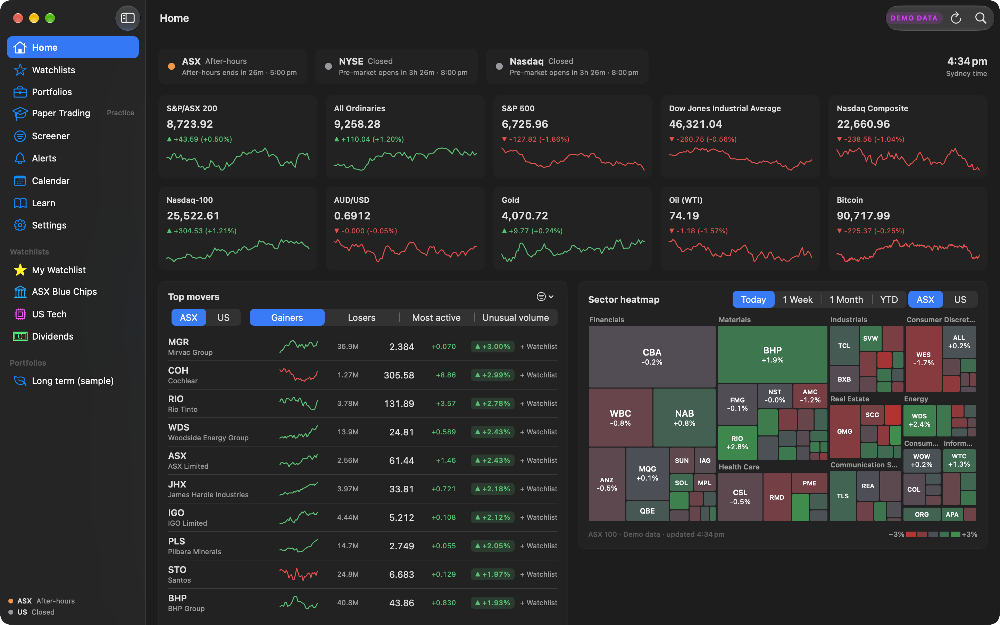
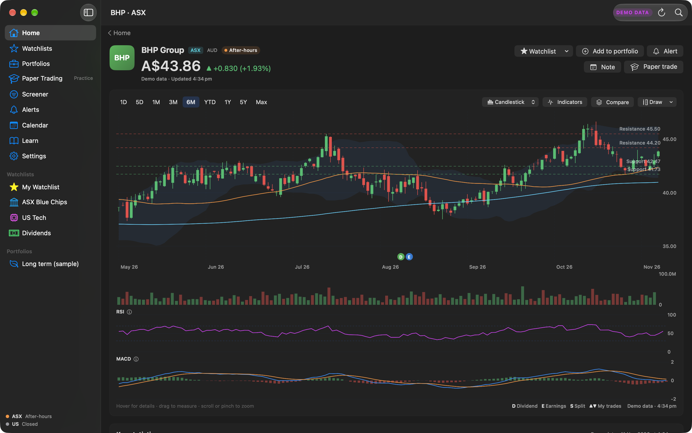
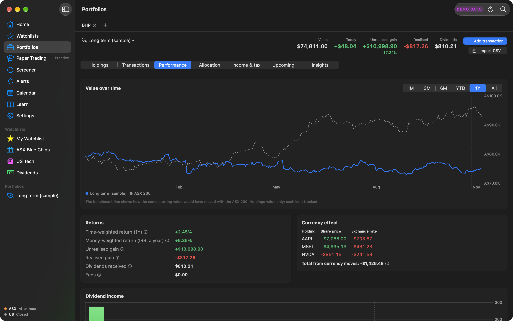
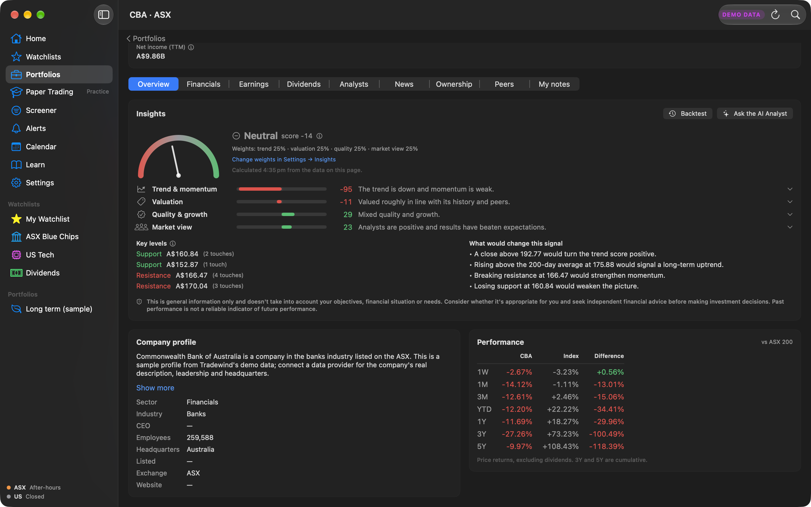
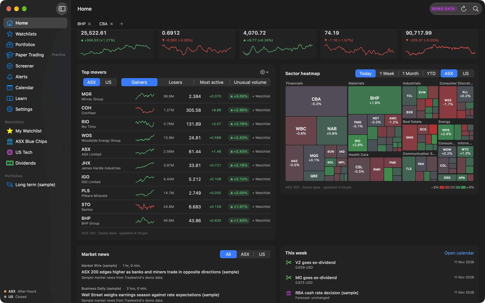
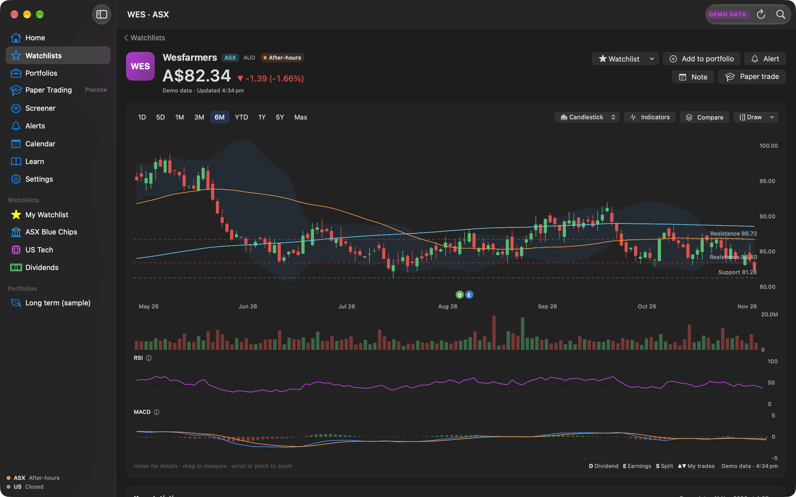

# Tradewind

**Follow the ASX, NYSE and Nasdaq in one place: watchlists, your portfolio, charts, insights and practice trading for your Mac.**

| Stock page with candlesticks and indicators | Portfolio performance |
|---|---|
|  |  |

| Sector heatmap and top movers, on free data plans | Back to exactly where you were |
|---|---|
|  |  |

## Features
- **Market overview**: ASX, NYSE and Nasdaq open/closed status with countdowns in Sydney time, index cards (S&P/ASX 200, All Ords, S&P 500, Dow, Nasdaq), AUD/USD, gold, oil and Bitcoin, top movers, a sector heatmap, market news and this week's calendar.
- **Sector heatmap and top movers that work on free data plans**: a treemap sized by market cap with Today, 1 Week, 1 Month and YTD, plus gainers, losers, most active and unusual volume, each labelled with its source and freshness.
- **Back navigation**: a back button, ⌘[ and ⌘], and a two-finger swipe return you to the same list, scroll position and filters.
- **Search** (⌘K) across ASX and US stocks and ETFs.
- **Full stock pages** in tabs: interactive charts (1D to Max; line, area, candlestick, OHLC) with SMA, EMA, Bollinger Bands, VWAP, RSI, MACD, Stochastic, ATR and On-Balance Volume, a crosshair, drag-to-measure, zoom, comparison overlays, dividend/earnings/split markers and your own trades; 30 key statistics explained in plain English; financials, earnings, dividends (with franking), analysts, news and ASX announcements, ownership, peers and private notes.
- **Insights you can see through**: an overall signal from −100 to +100 built from trend, valuation, quality and analyst views, with adjustable weights, support and resistance levels, what would change the signal, and an honest five-year backtest.
- **AI Analyst** (optional, with your own Claude API key): ask about any stock or get a daily portfolio summary.
- **Watchlists** with live price flashes, custom columns and drag-to-reorder.
- **Portfolio tracker**: multiple portfolios and currencies, dividends, DRPs, splits and fees, CSV import from CommSec, Stake, SelfWealth, Pearler, CMC Invest and others, performance against a benchmark, time- and money-weighted returns, currency effects, allocation charts and concentration warnings.
- **Australian tax helper** (an estimate, not tax advice): capital gains by financial year with the 50% CGT discount, FIFO or specific lots, franking credits and a CSV for your accountant.
- **Paper trading** with pretend money: market, limit and stop orders, brokerage, a trade journal and stats. Always marked PRACTICE.
- **Alerts** as macOS notifications: prices, big moves, moving averages, RSI, 52-week highs and lows, volume spikes, signal changes, earnings, ex-dividend dates and news.
- **Screener**, **calendar**, a **glossary** of every term, and a **menu bar ticker**.
- **Demo data** built in, so you can explore everything before adding a data provider.

## Requirements
- A Mac with Apple silicon (M1 or later)
- macOS 14 Sonoma or later
- For live prices: free API keys from any of [EODHD](https://eodhd.com/register) (the only official free source of ASX prices, about 20 a day), [Finnhub](https://finnhub.io/register), [Twelve Data](https://twelvedata.com/pricing), [Massive](https://massive.com) and [Alpha Vantage](https://www.alphavantage.co/support/#api-key). Tradewind spreads its requests across them. The cheapest way to remove the limits is EODHD EOD All World, US$19.99 a month (about A$29).

## Install
1. [Download Tradewind.dmg](https://github.com/MilkshakeSR/Tradewind/releases/latest/download/Tradewind.dmg).
2. Open the DMG and drag **Tradewind** into **Applications**.
3. The first time, right-click Tradewind in Applications and choose **Open**, then **Open** again. (Tradewind isn't notarized by Apple, so macOS asks once.)

## Updates
Tradewind checks for updates once a day and can install them for you. You can also choose **Tradewind → Check for Updates…** or change the settings in **Settings → Updates**.

## Privacy
- Your portfolios, transactions, watchlists, alerts and notes stay on your Mac. API keys are kept in your Keychain.
- Only ticker symbols go to your data providers. Exchange rates come from the European Central Bank's reference rates (Frankfurter) and short interest from ASIC's public files.
- Questions you ask the optional AI Analyst, with the data shown for that stock or portfolio, go to Anthropic using your own key.
- No analytics or tracking.

## Important
Tradewind is for tracking and information only. It never places real trades and never connects to a brokerage account.

> This is general information only and doesn't take into account your objectives, financial situation or needs. Consider whether it's appropriate for you and seek independent financial advice before making investment decisions. Past performance is not a reliable indicator of future performance.

## Help
- [Report a problem](https://github.com/MilkshakeSR/Tradewind/issues/new) (Help → Report a Problem… fills in your version details)
- [Version history](https://github.com/MilkshakeSR/Tradewind/releases)

© 2026 Steven Robertson. All rights reserved.
